# FragRush — Break, Blast, Bury

**A fast, fully destructible arena shooter that runs in your browser.**
Jump in, no accounts, no setup: fight bots in a neon-lit voxel arena, a sunny meadow of
treehouses, a creek and a lake, a dark volcanic valley cut by a creek of lava, a snowy valley
around a frozen lake with an ice castle, a moon base of glass domes in low gravity, or a giant kid's
room where you are a tiny robot. Almost every wall, tree and bridge can be blown apart, and whatever
collapses buries whoever stands below.

**▶ Play now: https://erenciracioglu-dotcom.github.io/FragRush/**


In the spirit of Quake 3 and Unreal Tournament: free-for-all deathmatch against bots, instant
respawn, rocket jumps, bunny hops and dashes. Hiding doesn't work for long, because cover doesn't
last.

| | |
|---|---|
|  |  |

## How to play

| Key | Action |
|---|---|
| WASD | move |
| Space | jump (hold to bunny hop); in deep water: swim up, hold at the surface to tread water |
| Shift | dash |
| C | crouch, slide while running; in deep water: dive |
| Left click | fire |
| Right click | zoom (railgun) |
| 1-5 / wheel / Q | select weapon / previous weapon |
| Tab | scoreboard |
| Esc / P | menu (pause; *Leave match* returns to the main menu); in menus: back, on the main menu: resume |
| Enter | play / resume |
| F3 | FPS and performance overlay |

**Rocket jump:** fire a rocket at your feet and jump at the same moment.

First to 25 frags (or the leader after 10 minutes) wins, then a fresh arena is generated.

Ctrl is not bound to anything: in Chrome, Ctrl+W closes the tab (crouch used to be on Ctrl too).

## Maps

Pick the map on the main menu: **MEADOW**, **VOLCANO**, **FROZEN LAKE**, **MOON BASE**, **TOY ROOM**,
**ARENA** or **ROTATE** (changes after every match: meadow, volcano, frozen lake, moon base, toy room,
arena, ...). *NEW ARENA* rebuilds the chosen map with a new layout seed. URL override for testing:
`?map=meadow`, `?map=volcano`, `?map=frozen`, `?map=moon`, `?map=toyroom` or `?map=arena`.

- **Arena**: the original neon sunset arena: central tower, four forts, bridges, corner yards.
- **Meadow**: a sunny afternoon in a valley ringed by cliffs. A great oak in the middle carries a
  wide treehouse deck and, at the very top, the lookout where the Doomsday Orb appears (four jump
  pads, or a rocket jump). Three more treehouses (lookout, creek house, lake house) hang on big
  trees and are joined to the oak by plank bridges; every treehouse has a spiral staircase and a
  jump pad. A creek springs from a cave in the west cliff and winds into a small lake; there is a
  dock, a diving board from the lake house, footbridges, a hunter's stand, boulders, logs and
  bushes. Everything is voxels and breaks: cut a trunk and the crown (and whoever is in the
  treehouse) comes down. Only the cliff core and the bedrock are indestructible.

| | |
|---|---|
| 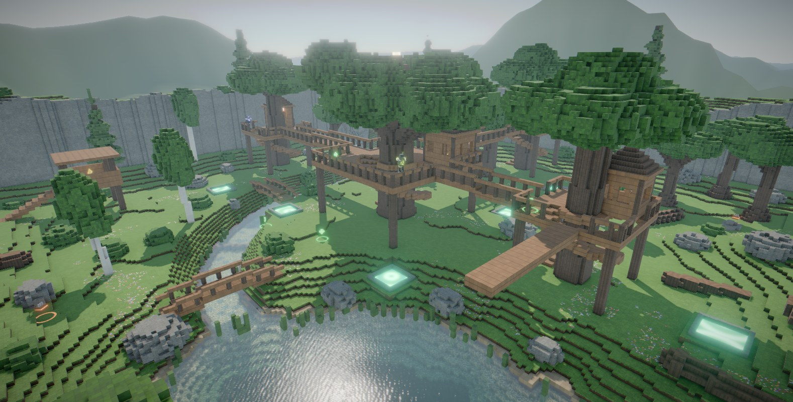 | 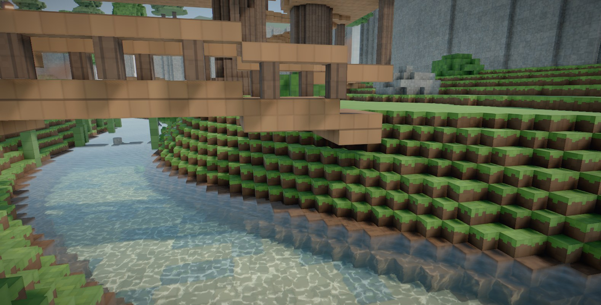 |
| 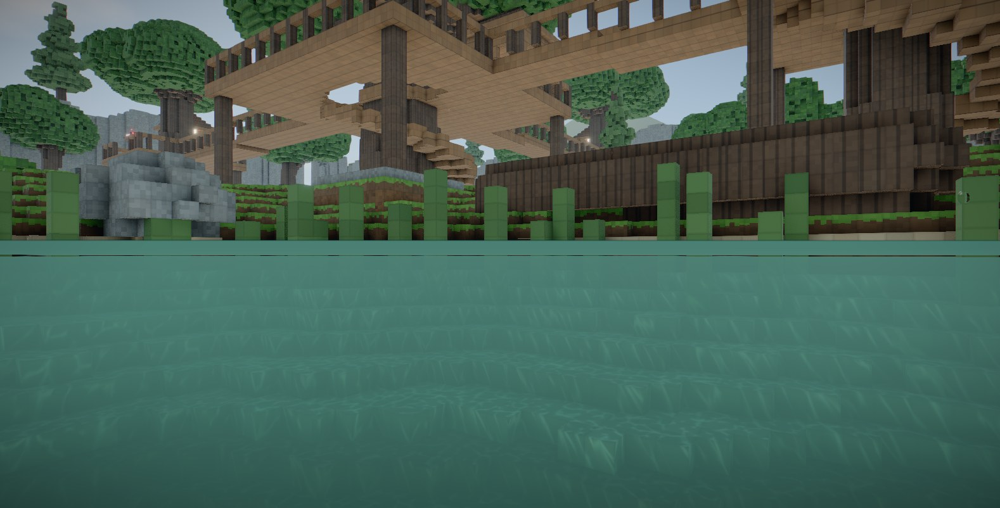 | 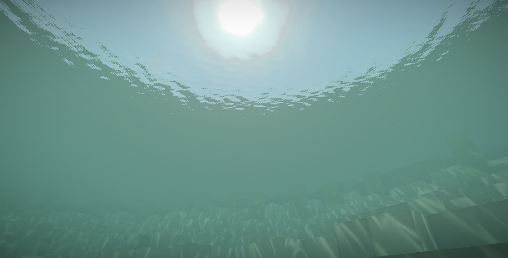 |

- **Volcano**: the meadow's dark twin, at night under a sky of ash with a volcano erupting on the
  horizon. No trees: an obsidian spire stands in the middle with a wide stone deck and, at the very
  top, the lookout ring where the Doomsday Orb appears (four jump pads, or a rocket jump). Three
  basalt towers with stone huts and spiral staircases are joined to the spire by iron grate bridges,
  each with its own jump pad, and a watch hut stands on basalt legs. A narrow creek of lava runs
  from a cave in the west cliff into a small, shallow lava pond (together a little under a third of
  the meadow's water surface); three natural basalt arches cross the creek. The Mega Health waits on
  a basalt islet in the middle of the pond: two obsidian stepping stones lead there, one careless
  jump and you burn. Obsidian crystals, basalt column fields, glowing magma cracks, steaming vents
  and braziers fill the valley; embers drift and ash falls. Everything breaks except the cliff core
  and the bedrock.

| | |
|---|---|
| 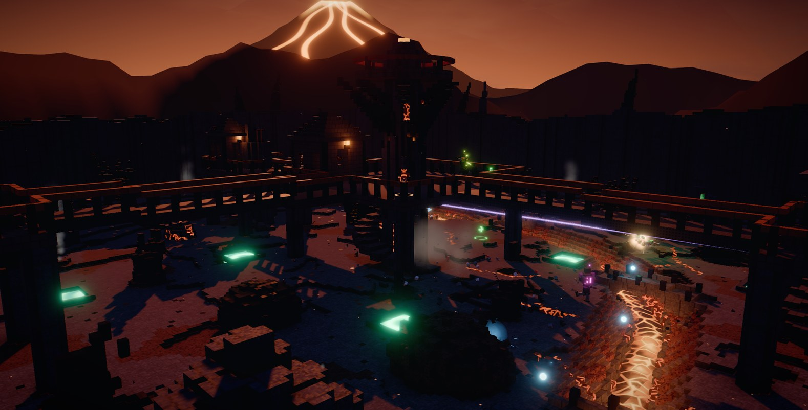 | 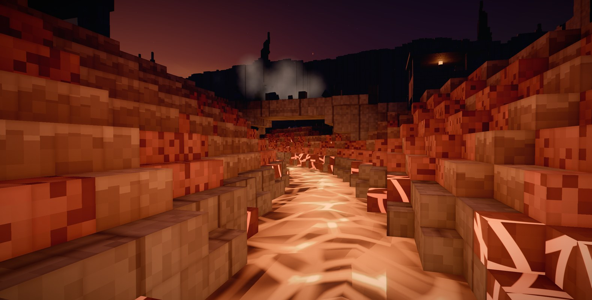 |
| 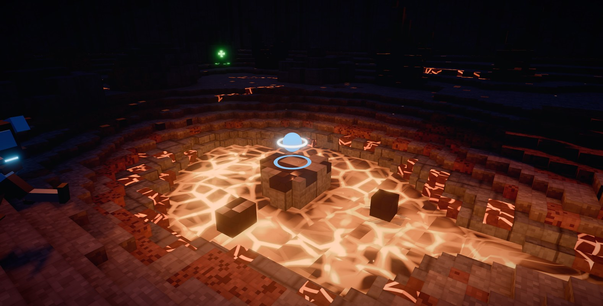 | 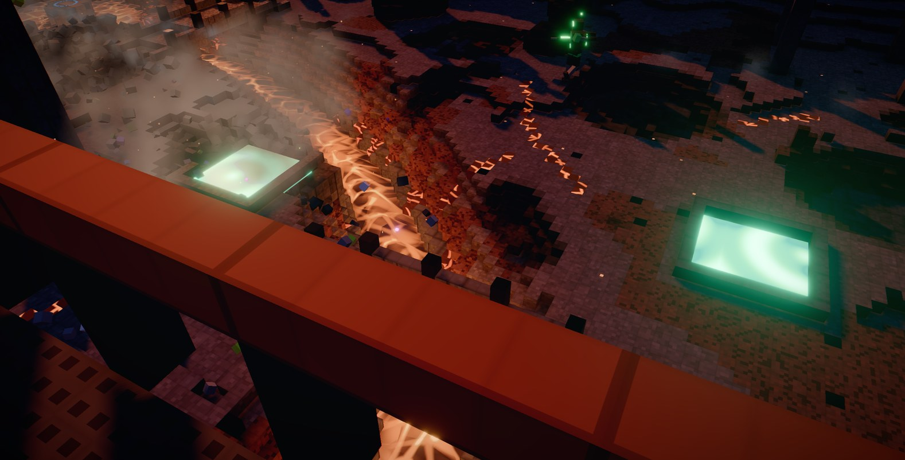 |

- **Frozen Lake**: a snowy valley on an overcast winter afternoon, snow falling, the lake in the
  middle frozen over. On an island in the lake stands an ice castle: a low crenellated wall with four
  gates and four turrets with braziers on top, and in the middle an ice-brick keep with a spiral
  staircase around it, up to the lookout where the Doomsday Orb appears (four jump pads on the shore,
  or a rocket jump). A wooden footbridge runs from the south gate to the shore. Around the lake: two
  log cabins with smoking chimneys, a hunter's stand on stilts, a pier with a fishing hole cut in the
  ice (the Mega Health lies on the lake bottom below it), snowy pines, boulders, fallen logs,
  snowdrifts and snowmen. A frozen creek comes out of a cave in the west cliff. Icicles hang from the
  eaves, the turrets and the lookout. Everything breaks except the cliff core and the bedrock.

| | |
|---|---|
| 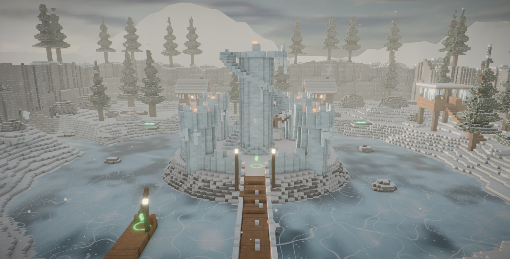 | 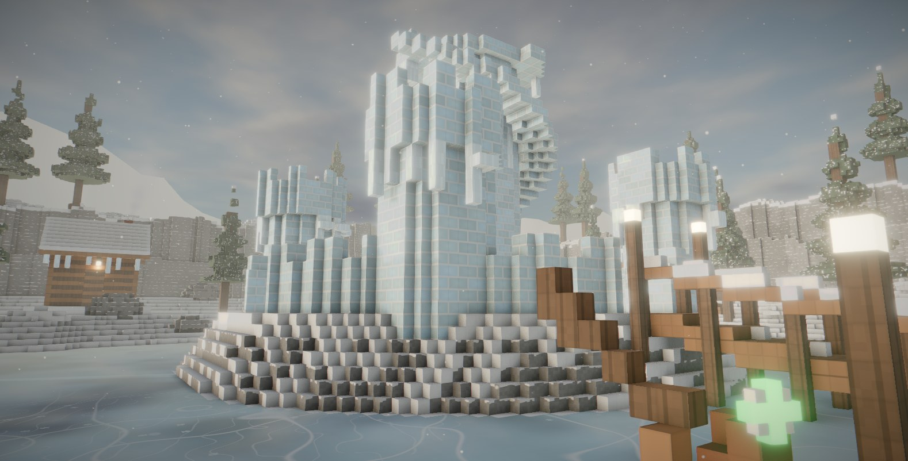 |
| 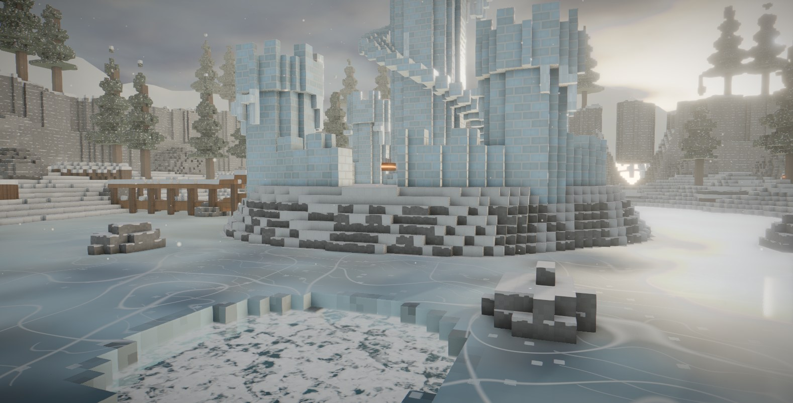 | 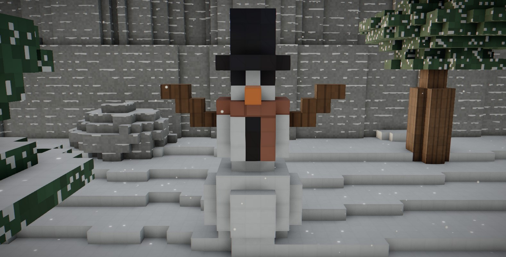 |

- **Moon Base**: a base of glass domes on the floor of a large crater, under a black, starry sky with
  the half-lit Earth hanging above the horizon; the sun is low and harsh and casts long, sharp
  shadows. Gravity is about a third of normal: you jump more than twice as high, rocket jumps go
  nearly three times as high and carry you over the domes, and debris drifts down slowly. Four domes are joined by pressurized tube
  corridors: a greenhouse with a tree, planting beds and pink grow lights, a command center with a
  map table and glowing screens, a habitat with a dining table, bunk beds and a kitchen, and a lab
  with benches of sample tubes and a moon rock on a pedestal. Their doorways are force fields that let
  you and your shots through but hold the air in. Between the domes stands a comms tower: the
  Doomsday Orb appears in its dish (three jump pads around the tower, or a rocket jump), and steps
  on its east face lead halfway up. North of the base lies a field of solar panels you can walk
  under; to the east a narrow canyon cuts across the map, crossed by a steel bridge, and beyond it
  are the landing pad and a lander you can climb. Containers, a six-wheeled rover, fuel tanks,
  craters and boulders give cover. The Mega Health waits under the tree in the greenhouse.
  Everything breaks except the crater rim and the bedrock.

| | |
|---|---|
| 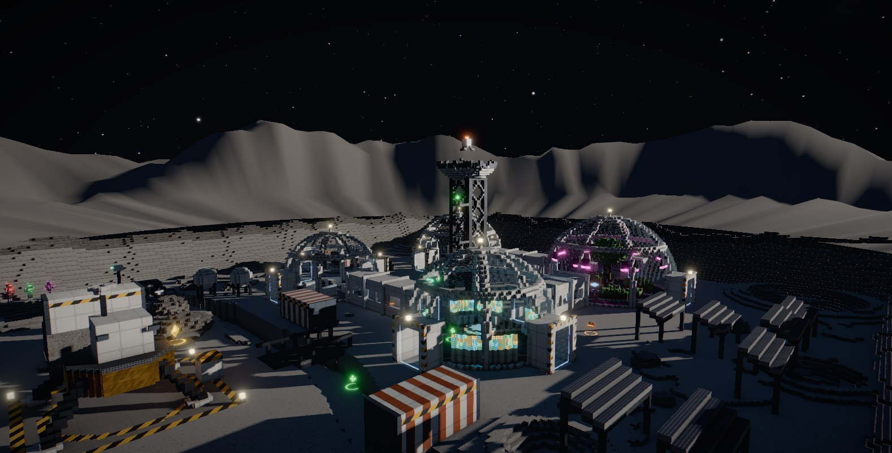 | 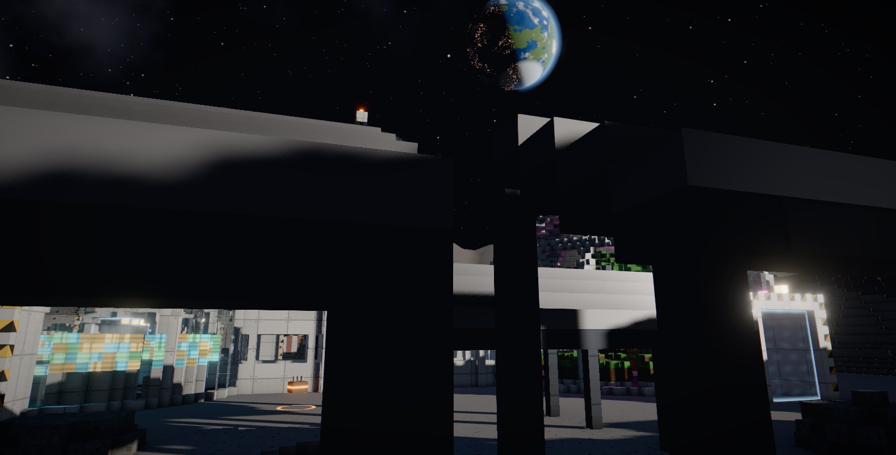 |
| 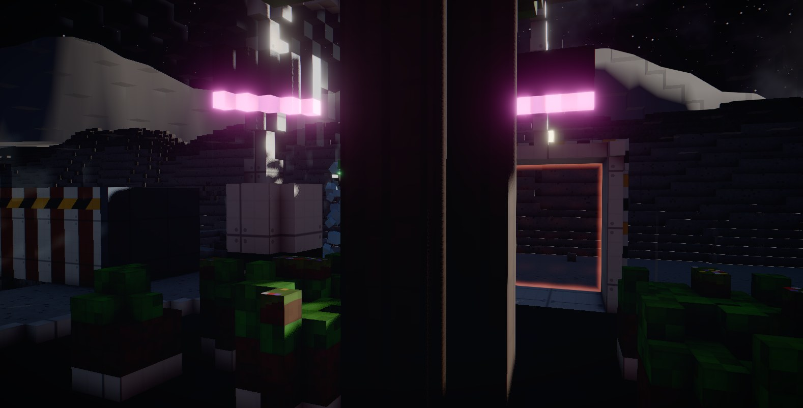 | 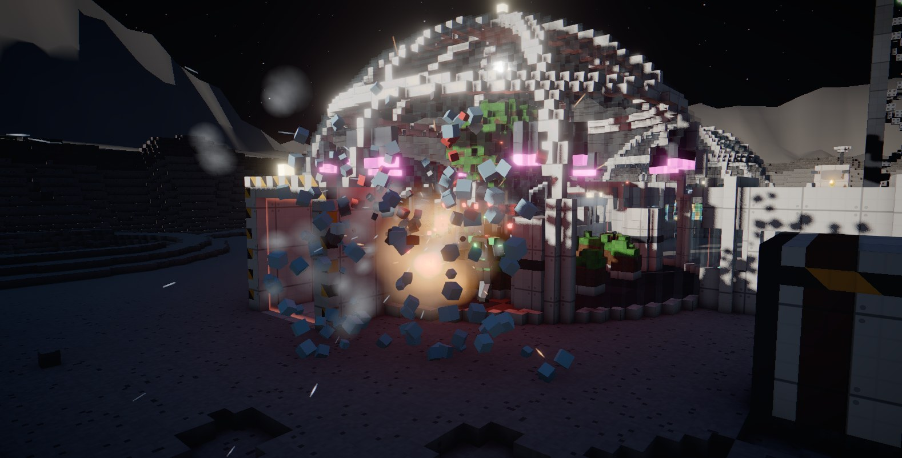 |
| 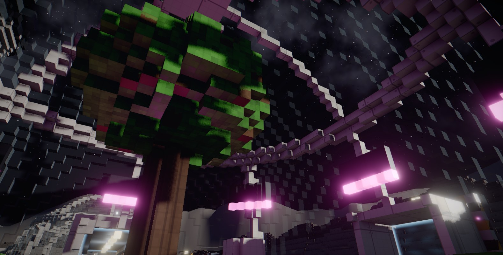 | 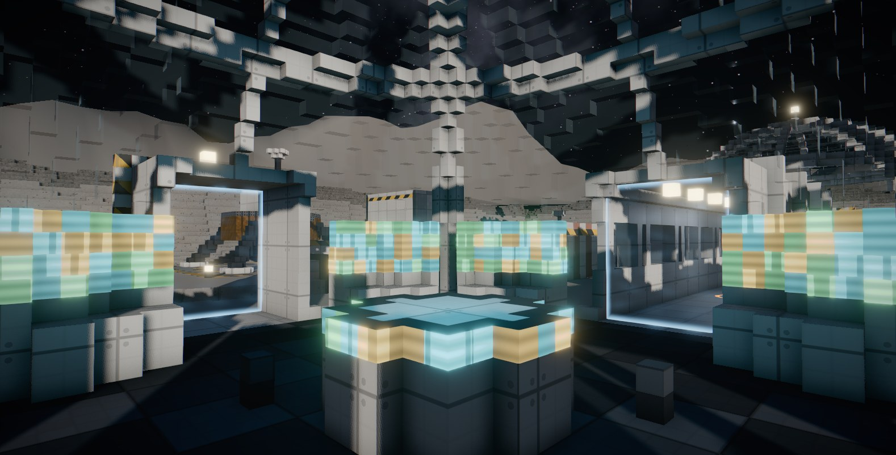 |

- **Toy Room**: you are a tiny robot (about 18 cm tall) in a giant kid's room, about ten times life
  size: the 7 × 7 m room is 70 × 70 m. Daylight falls through a wide window with the curtains drawn
  aside, in shafts of light full of floating dust. On the north wall a bookshelf is the climbing
  route (the shelves and the stacks of books sticking out of them are the steps), and from its top a
  ruler bridges over to the 20 m wardrobe, where the Doomsday Orb waits (or take one of the two jump
  pads). The bed is a giant trampoline: the mattress, the duvet, the pillows and a rubber ball throw
  you back up. You can walk under the bed, and the Mega Health lies there. Next to it a nightstand
  with a night light, toy blocks to climb onto the bed and a giant crayon leaning on it; across the
  room a desk with a lamp, a pencil cup and books, and a chair. In the middle a rug with a printed
  race track, ramps and toy cars; in the corners a toy castle, a toy chest, a teddy bear and a city
  of blocks. From the castle gate a line of 22 giant dominoes curves across the floor to a 13 m tower
  of wooden blocks: knock over the first one and the last one brings the tower down. The inner layer
  of the walls and the ceiling (wallpaper, plaster) breaks, the brick behind it doesn't.

| | |
|---|---|
| 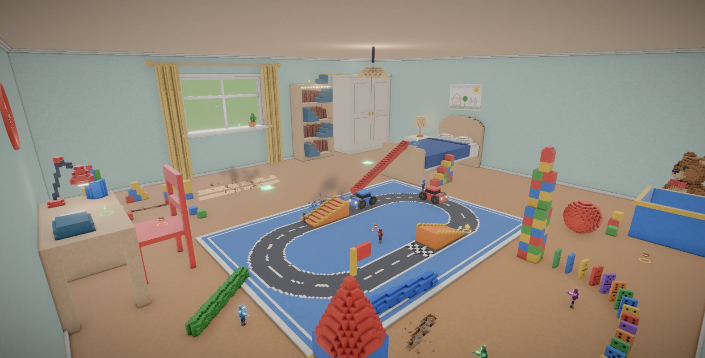 | 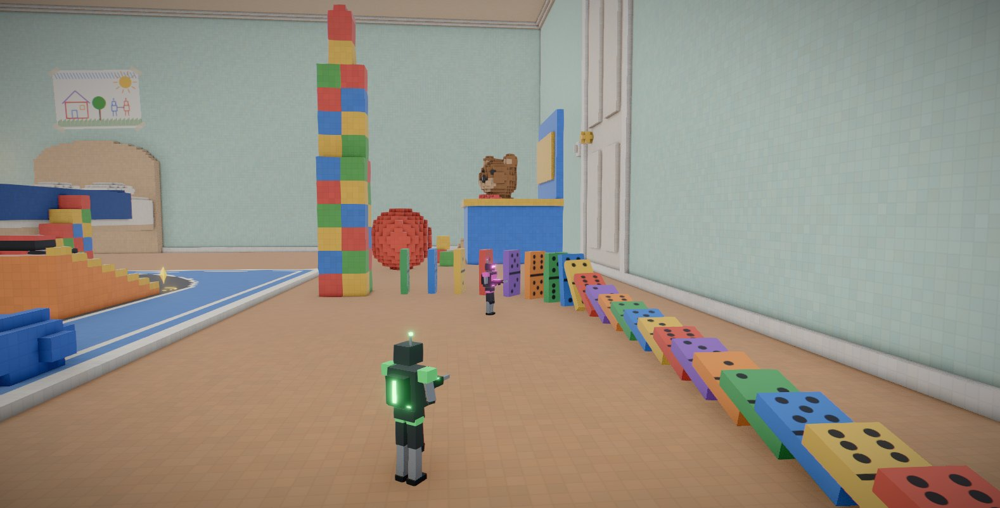 |
| 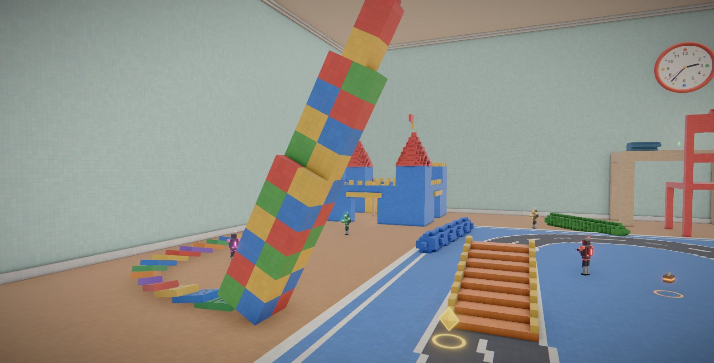 | 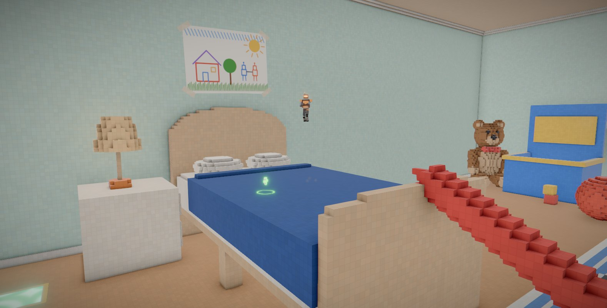 |
| 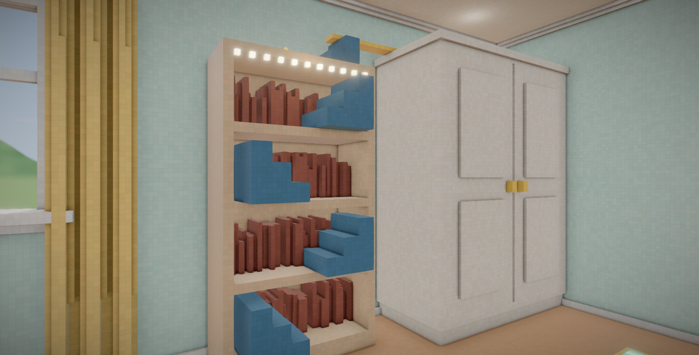 | 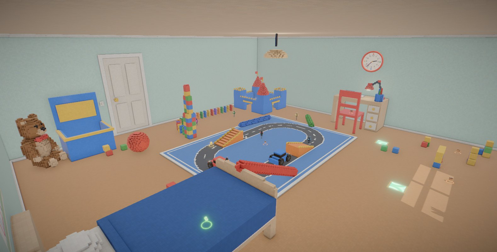 |

### Water (meadow)

Every empty voxel below the water level is water: the creek, the lake, and any crater you blast
down to that depth. The water you see and the water you move through are the same.

- **Creek** (about 0.5 m deep): you wade, slower the deeper you are (about 60 % of running speed),
  jumps and dashes are weaker. You can still shoot.
- **Lake** (up to about 3 m): you swim at about 40 % of running speed, in the direction you look.
  You slowly sink unless you hold **Space**; holding Space at the surface keeps your head above
  water. **C** dives. Swim into the shore near the surface to climb out (banks up to 1 m), or walk
  out on the shallow beaches.
- **Head under water: no shooting.** The weapon is lowered and the crosshair dims.
- **Air:** 12 seconds (the AIR meter appears under the crosshair). After that you take damage every
  second (10, 15, 20, ... ignores armor). Drowning is a **self frag (−1)**. Surfacing refills the
  air at once.
- The **Mega Health** lies at the bottom of the lake: dive for it, but you can't shoot down there.
- Rockets that explode in or near the water raise a water column with rings, a flash and a gas
  bubble seen from below; bullets and projectiles splash where they cross the surface. Underwater
  the sound is muffled. Surfacing leaves drops and a draining film on the lens.
- Bots wade the creek, avoid deep water, never fire while submerged and swim back to the nearest
  shore if they end up in the lake. They ignore the Mega Health on the lake bottom.

### Lava (volcano)

Every empty voxel below the lava level in the creek, the pond and right next to them is lava: blast
a crater that deep within about a meter of the lava and it fills with lava; craters further away
stay dry. Blast the ground away beside the lava and it does not drain: it stands at its level as a
glowing wall of lava at the edge of the crater. The lava you see is the lava that kills.

- **Touching lava kills instantly**, armor or not. Fall in on your own and it counts as a
  **self frag (−1)**.
- **Push someone in and the frag is yours** ("INTO THE LAVA!"): whoever hit them in the last
  4 seconds, with a rocket blast or anything else, gets the credit.
- The lava lights the banks around it, embers rise from it, bubbles pop and you can hear it rumble
  when you get close.
- Bullets stop at the surface and at lava walls, rockets and plasma bolts explode on them with a
  splash of lava, rail shots splash through. Items that fall in burn and come back at their spot
  later; debris melts.
- Bots keep away from the edge: they don't run, jump or dash toward the lava, brake when their
  momentum would carry them in, and cross on the arches and bridges. They ignore the Mega Health on
  the islet. They can still be blasted in.

### Ice (frozen lake)

The lake is covered by ice half a meter thick, and the water under it is freezing. As on the meadow,
every empty voxel below the waterline is water.

- **The ice breaks**: rockets and plasma punch holes in it, bullets chip it. It is **slippery**: you
  pick up speed slowly and slide a long way before you stop.
- **Freezing water** takes health every half second (5, 6, 7, ... up to 12, ignores armor) and the
  screen frosts over. Get out fast.
- **Break the ice under someone and the frag is yours** ("THROUGH THE ICE!"): if they fall through
  ice you broke in the last 3 seconds and freeze or drown within 14 seconds, you get the credit. Fall
  in on your own and it counts as a **self frag (−1)**.
- **The ice is a ceiling**: under it you can't come up for air. Find a hole, or hold **Space** under
  the ice for about a second to break through from below.
- **Broken ice freezes over again** from the edges inward, surface first: a rocket hole can be walked
  on again after about 15 seconds and is solid in under a minute. Floes cut loose float. The fishing
  hole at the end of the pier never freezes.
- **Icicles**: shoot one at the root and it breaks off; it hurts whoever stands below (bigger ones
  hurt more) and the damage is yours ("ICICLE DROP!").
- **Snowmen** hide armor, health or ammo inside: blast one open to find out. Bots don't know.
- Bots walk across the ice and path around the holes. If they fall in, they swim for the nearest
  edge; trapped under the ice, they break through from below.

### Air (moon base)

Each dome, together with its entrance corridors, and each tube corridor holds its own air. Outside
there is none.

- **Low gravity**: about a third of normal. Jumps go more than twice as high (about 2.7 m) and hang
  in the air, rocket jumps nearly three times as high (over the domes), and debris and dust fall
  slowly.
- **The glass breaks**: a stray bullet only cracks a pane; a few more hits, one rocket or one plasma
  bolt punch a hole, and the glass around the hole bursts.
- **Air leak**: once a dome or tube is open to the vacuum, its air rushes out for 3–4 seconds.
  Everything inside (players, bots, items, debris, smoke) is pulled toward the nearest hole, lifted
  off the floor and blown out into the low gravity. Red alarm lights flash, a horn blares, vapor and
  ice crystals jet from the hole. Get away from the hole: the pull is strongest close to it.
- **Damage**: going out through the hole costs 35 health, and slamming into something at speed hurts.
- **Blow someone out and the frag is yours** ("SPACED!"): whoever dies within 6 seconds of your
  breach from the decompression, the blow-out or the impact is credited to you. Die in a dome you
  breached yourself and it counts as a **self frag (−1)**.
- **Foam patch**: about 25 seconds after the breach the hole is sealed with foam (it waits while
  someone stands in the hole) and the dome fills with air again. The foam can be shot through again.
- **Vacuum**: outside, sound is muffled and smoke doesn't linger; inside, the air vents hum and the
  consoles beep.
- Bots know the low gravity: they predict where their jumps land and use the long jumps it allows.
  When they see an enemy through the glass of a dome that still holds its air, they shoot the glass
  (preferring rockets, plasma and the railgun), and when the air starts to leak they run against the
  flow, away from the hole.

### Toys (toy room)

- **Trampolines**: the mattress, the duvet, the pillows and the rubber ball are bouncy. Land on them
  fast enough and you bounce back at about 80 % of your landing speed; hold **Space** as you land for
  an extra push (up to about 5 m high). The bounces die down, and a gentle step doesn't bounce.
- **Dominoes**: 22 giant dominoes (2 m tall) stand in a curving line from the castle gate to the
  block tower. **Shoot the first one**: each domino tips over on its bottom edge, speeds up and
  knocks over the next, the wave reaches the end in about four seconds, and the last domino tips the
  13 m tower over its front edge like a falling tree onto the rug.
- The dominoes are heavy: the first one falls at a single hit, the others only rock when a stray
  bullet hits them (a few pulse rounds, a close shotgun blast, two plasma bolts, a rail slug or a
  rocket knock one over). A domino falls away from whoever knocks it over, so hitting one from the
  tower side sends the wave back to the start. A domino shot while a wave is running toward it falls
  the same way as the wave, so crossfire doesn't cut the line.
- **DOMINO!**: whoever the tower crushes or catches as it slams down, and whoever a falling domino
  lands on (40 damage, and a shove), is credited to the player who knocked over the first domino of
  that run. Get crushed by your own tower and it counts as a **self frag (−1)**. A warning shows when
  you stand where the tower will fall while the line is running.
- **Reset**: about 45 seconds after a run starts, the dominoes stand up again (a domino waits while
  someone stands in its place) and the tower rebuilds itself layer by layer. A shot-up tower repairs
  itself too, and every match starts with the line set up.
- Bots know the room: they bounce on the bed without getting stuck and climb the bookshelf to the
  orb. When an enemy stands where the tower would fall (and isn't just passing through), a bot that
  can see a domino shoots it: the first one, or one near the tower that falls the right way and brings
  the tower down within two seconds. When a line is running, the bots that notice get out of the way.
- The wall clock ticks (real time), birds chirp outside, a music box plays as the match starts,
  rubber toys squeak, the blocks and dominoes clatter (all synthesized).

### Weapons

1. **Pulse Rifle**: rapid fire, slowly carves through walls
2. **Shotgun**: close range, shreds cover
3. **Plasma Gun**: fast bolts with small blasts, great for drilling concrete
4. **Rocket Launcher**: big craters, brings structures down, rocket jumps
5. **Railgun**: pierces up to 14 m of wall and hits whoever is behind it

### Doomsday Orb

Spawns on the roof of the central tower, reachable only with jump pads or a rocket jump.
For **15 seconds every hit kills**: every pulse bolt, every shotgun pellet, every plasma bolt,
every rail. Rocket blasts become **5× larger** (≈12 m craters, ≈21 m damage radius). Your own
blasts throw you around but don't hurt you.

### No camping

- Bots hear gunfire, come to where you were last seen and blast through the cover between you.
- Stay in the same small area for more than 15 seconds and **your position is revealed**: the
  three nearest bots learn where you are and come to break your cover (you get a warning at 10 s).
- Walls, columns and bridges break. Anything that loses its connection to the ground collapses
  and crushes what is below. Bring a ceiling down on an enemy and the frag is yours
  ("BURIED IN RUBBLE").

### Settings

Map (main menu), language (English / Türkçe), mouse sensitivity, field of view, graphics quality
(Ultra / High / Medium / Low), bot count (0-11, can be changed mid-match), bot difficulty
(7 levels from Rookie to Nightmare), volume, invert mouse, FPS overlay.
Three of the bots are family: **Papa Eren**, **Eray the Kid** and **Mama Aigul**.


## Requirements

- A desktop browser with **WebGL 2**. Chrome or Edge recommended (tested in Chrome).
- Mouse and keyboard. Mobile is not supported.
- A dedicated GPU is recommended. Unless you pick a quality yourself, the game starts on **Low**
  on integrated graphics, **Medium** on older dedicated GPUs and **High** on RTX / Radeon RX 5000+
  class GPUs; change it in Settings (press F3 to see FPS).
- The first match shows a short controls card (H hides it; it appears only once).
- No install, no downloads. The online version counts anonymous visits with
  [GoatCounter](https://www.goatcounter.com) (no cookies, no personal data); local copies don't.
- No other network use after the page has loaded (everything, including all sound,
  is generated in the browser).

**If the picture freezes every few seconds, update your graphics driver.** On the test laptop
(Intel integrated graphics + RTX 5080), Intel driver 32.0.101.6629 (February 2025) froze the
picture for 0.3–0.8 s every 6 seconds whenever anything was animating: the game, a page with
nothing but a CSS animation, and a small native Direct3D test program alike. Intel driver
32.0.101.9150 (October 2026) fixed it.

**Laptops:** if the game runs slowly, the browser is probably on the integrated GPU (the menu
shows a warning when it is). On Windows, set the browser to "High performance" in
*Settings → System → Display → Graphics* and restart the browser, or use the launcher below.
Laptops with a MUX switch can also be set to "dGPU only".

## Run locally

The whole game is a single file: `docs/index.html`. You can open it directly in Chrome.

**Windows launcher:** `FragRush.bat` starts a small local server (if [Node.js](https://nodejs.org)
is installed) and opens the game in a separate fullscreen Chrome window on the high-performance GPU.
The server closes itself about 45 s after the game window is closed.

**From source:**

```
npm install
node build.mjs      # builds dist/index.html and docs/index.html
node serve.mjs      # http://127.0.0.1:8777/
```

## Performance

Measured on an RTX 5080 Laptop at 2560×1362, Ultra:

- ~240 FPS average, 99th percentile frame time 8 ms.
- 30 seconds of non-stop Doomsday rockets (one per second, the arena almost completely leveled,
  ~380k voxels removed): worst frame 12 ms, no frame over 20 ms.
- 5-minute heavy-destruction soak tests: stable memory (no leaks), no shader compiles during play.
- On most hybrid-graphics laptops the built-in screen is driven by the integrated GPU even when the
  game renders on the dedicated one, so keep the integrated GPU's driver up to date as well.
  "dGPU only" (MUX) mode takes the integrated GPU out of that path.

Benchmark page: `?bench=30&q=ultra` (local server, writes results to `reports/`), add `&map=meadow`,
`&map=volcano`, `&map=frozen`, `&map=moon` or `&map=toyroom` for the other maps (on the moon base,
`&breach` breaches a dome every 4 seconds; in the toy room, `&domino` sets up the line and runs it
into the tower every 7 seconds).

The meadow is heavier than the arena (more triangles in trees and grassy slopes, plus water). On the
test laptop's **integrated** GPU (Intel Graphics 0x7D67, Chrome/ANGLE D3D11, Low quality, 1104×561,
25 s bot-following benchmark with large blasts): arena ~207 FPS (GPU 4.2 ms/frame), meadow ~134 FPS
(GPU 6.4 ms/frame). Measured at fixed views with GPU timer queries, the water (per-frame wave/foam
updates + drawing) costs about 0.9 ms per frame at Low on that GPU, and drawing it about 1.1 ms at
High (1578×802). The underwater and lens passes run only when the camera is at or below the
waterline or the lens is wet, and ambient occlusion is switched off while fully underwater.

The volcano sits between the two: it has no trees but adds the lava surface, its glow on the voxels
and embers. The frozen lake is close to the meadow: snowy slopes and pines, the ice, snowfall, and
the water under the holes is drawn by the same water pass. Run back to back on the same integrated
GPU at Low in a larger window (1563×831), the arena averaged 115 FPS (GPU 7.5 ms/frame), the volcano
84 FPS (10.4 ms), the frozen lake 71 FPS (12.4 ms) and the meadow 66–79 FPS (11.4–13.5 ms over two
runs; the slower one had twenty structures collapsing in view). The bots follow a different path in
every run, so what gets blasted and how much falls varies. Measured the same way later, the moon base
averaged 85 FPS (GPU 10.7 ms/frame). A worst-case run that breached the nearest dome with a plasma bolt
every 4 seconds (`&breach`) averaged 90 FPS, and no frame took longer than 20 ms. The toy room averaged
101 FPS (GPU 8.8 ms/frame); a worst-case run that rebuilt the block tower (about 2,200 voxels
written at once) and ran the whole domino line into it every 7 seconds, with the camera taking in the
whole room (`&domino`), averaged 93 FPS, and no frame took longer than 16 ms.

## How it works

- **Three.js r186 + WebGL 2**, bundled with esbuild into one self-contained HTML file (~1.5 MB).
- **Voxel world**: 72 × 24 × 72 m at 25 cm resolution (~8 million cells). Each material has its own
  toughness and per-voxel damage: concrete cracks and darkens before it breaks, steel holds longer,
  wood and glass break easily. Bedrock and the outer frame are indestructible.
- **Meshing**: greedy meshing with per-vertex ambient occlusion in 6 Web Workers. Changed chunks are
  re-meshed nearest-to-camera first; GPU buffers are allocated with headroom and updated in place,
  and new allocations are spread over frames so huge blasts don't stall the driver.
- **Structural integrity**: after each blast, islands that lost their connection to the ground are
  found with a downward-biased flood fill (~2 ms), fall as rigid bodies and break into debris and
  rubble on impact.
- **Rendering**: sunset sky and environment map, 4K shadow map, N8AO ambient occlusion, bloom, AgX
  tone mapping, color grading, SMAA, per-voxel color variation, bevels and material patterns,
  instanced particles and debris, a fixed-size dynamic light pool (no shader recompiles).
  All shaders are compiled up front.
- **Bots**: multi-level navigation grid that updates as the arena is destroyed (a node stands on the
  highest ground within one step of its cell, so slopes and drifts are walkable), A* pathfinding,
  target selection, strafing, jumping, dashing, rocket dodging, jump pads. When stuck they drill
  through walls. Near lava they trace where their run, jump or dash would end (steps, drops, the
  arc of a jump) and brake or turn away before it ends in the lava.
- **Audio**: fully synthesized with WebAudio at runtime (no sound files), 3D positioned with reverb.
- **Water (meadow)**: [water.js](src/vendor/water.js) (our own WebGL2 water library, vendored as
  one file) drawn inside the Three.js post-processing chain with raw WebGL calls: the surface is
  drawn after AO with refraction from a half-resolution copy of the scene, a creek flow map and
  interactive ripples; an underwater pass (only when the camera is at or below the waterline)
  applies water absorption, scattering, caustics and the explosion flash to the scene from the depth
  buffer; a lens pass adds drops and the waterline. water.js's physical sky is converted once into a
  Three.js cube map for the background and the lighting environment, so the sky, the reflections in
  the water and the lighting of the voxels match.
- **Lava (volcano)**: one rule everywhere: an empty voxel below the lava level inside the lava area
  (creek and pond plus a 1.25 m margin) is lava. Drawing, the kill check, bullets, projectiles,
  items, debris and the bots' navigation all use it. The surface is a flat mesh over that area with
  its own shader (a crust of moving cells with glowing cracks, carried along a flow map, cooler at
  the banks); a low-resolution proximity map lights nearby voxels from below. Where the ground
  beside it is blasted away, the exposed sides of the lava are drawn as walls, rebuilt as the terrain
  changes. The night sky (ash
  clouds, the distant volcano with lava streaks and a glowing plume) is a shader, also baked into
  the environment map for reflections. The lava's rumble, bubbles and sizzle are synthesized too.
- **Ice (frozen lake)**: the lake ice is two layers of voxels at the waterline, drawn with its own
  material pattern (dark clear patches, frost, a world-space crack network, frozen bubbles). Each
  blast records who broke which column and when; whoever drops into the water looks up the ice broken
  around them in the last 3 seconds for the credit. Broken ice goes into a refreeze queue and grows
  back from the edges inward, surface layer first, never inside a body. Ice at the waterline counts as
  anchored, so floes cut loose float instead of sinking. Icicles that break off fall as rigid bodies
  and hurt what they land on. Snowfall is a few thousand GPU points in a box around the camera,
  hidden under roofs and trees by a top-down height map that follows the destruction; chimneys smoke,
  the wind howls louder up high and the ice booms in the distance (all synthesized).
- **Moon base**: gravity is a property of the map (7.7 m/s² here, 22 m/s² elsewhere), and movement,
  jump pads, the bots' landing predictions and navigation links (higher jumps, longer drops),
  falling structures, debris and items all read the current value. The pressurized volumes are
  found when the map is built, by a flood fill from inside each dome and tube that stops at the
  shell and at the force-field doorways. When a blast opens the shell to the outside, the volume
  vents: a breadth-first distance field from the holes (a few milliseconds for the largest dome, once
  per breach) gives the direction of the flow everywhere inside, its speed falls off with the distance
  to the hole and with the pressure left, and actors, items, debris and smoke are carried along. The
  foam patch refills the removed shell voxels. The dome glass is meshed apart from the opaque voxels
  and drawn as a transparent surface that is nearly invisible head-on, more reflective at grazing
  angles, and frosts and cracks as it is damaged; bots see through it, bullets don't pass. Outside
  the volumes, smoke falls ballistically and every sound except the interface goes through a
  low-pass filter. The black sky (stars, a faint Milky Way, a small white sun, the half-lit Earth
  with generated oceans, continents, clouds, an atmosphere rim and city lights on its night side) is
  a shader, also baked into the environment map.
- **Toy room**: the dominoes are not voxels but objects (a box mesh each). Each one tips over its
  bottom edge as a thin slab under gravity (held back while its center of mass is behind the edge,
  speeding up once past it); when its top touches the next one it hands over most of its speed, then
  leans on it and follows its angle, so a finished line lies like roof tiles. Standing or lying, each
  domino writes its box into a separate layer of virtual solid cells that movement, bullets, line of
  sight and the bots' navigation grid see but the mesher doesn't, so dominoes block paths and stop
  bullets without being destructible voxels. The block tower is ordinary voxels: when the last domino
  touches its bounding box (even if it has been shot full of holes), its voxels are lifted out as one
  rigid body that rotates about its front bottom edge like a hinge until it hits the floor and breaks
  into rubble; whatever it crushes is credited to whoever started the run. A snapshot of the tower
  taken when the map is built is written back layer by layer when the line resets. Bouncy surfaces
  are a material table like the slippery ice: landing on one above a speed threshold reflects the
  vertical speed. The window light is a set of camera-facing beam cards with soft edges and drifting
  dust motes (GPU points); the daylight sky outside is a small shader.

```
src/            source (src/config.js: all tunables in one place)
  world/        voxel world, materials, mesher (+ worker), map generators (arena, meadow, volcano, frozen lake, moon base, toy room), levels, voxel shader
  game/         game loop, movement (incl. swimming, ice, per-map gravity, trampolines), weapons, bots, destruction, items, navigation, domino chain
  fx/           sky, post-processing, water bridge, lava, ice and snow, moon base (sky, air leaks), toy room (dominoes, block tower, window light), environments, particles, debris, lights
  vendor/       water.js
  audio/ ui/    sound synthesis, HUD
docs/           built single-file game (served by GitHub Pages)
serve.mjs       dependency-free local server
build.mjs       build script
test/           headless tests (movement, world, water, meadow, volcano, frozen lake, moon base, toy room, flows, screenshots)
tools/          benchmark scripts
```

## Status

Proof of concept, built with Claude. Bots only, no multiplayer (yet). Water does not flow: blasting
a lake bank does not drain the lake, and a deep crater anywhere fills with water from the water table.
Lava does not flow either: where it can be is fixed when the map is built, so digging under it leaves
a standing wall of lava. Air is simplified too: it follows a precomputed field toward the holes
rather than a fluid simulation, and an opened dome empties in a few seconds whatever the size of the
hole. The dominoes are simplified as well: they only tip along the line (a blast knocks one forward or
back, never sideways), and the block tower always falls the same way. Weapon models and robots are
simple procedural boxes. Very large structures (over 160k
voxels) are treated as fixed and don't fall.
Sound starts after the first click (browser rule).

---

## Türkçe

**FragRush**, tarayıcıda çalışan, neredeyse her şeyin parçalanabildiği hızlı bir arena FPS'i.
Hesap yok, kurulum yok: gir, neon ışıklı voxel arenada botlarla kapış, duvarları, kolonları,
köprüleri havaya uçur, çöken binaların altında rakiplerini göm.

**▶ Hemen oyna: https://erenciracioglu-dotcom.github.io/FragRush/**

- Quake 3 / Unreal Tournament ruhu: herkes herkese karşı, ölünce anında yeniden doğuş, roketle
  zıplama, tavşan zıplaması, atılma. 25 parçalamaya ulaşan (ya da 10 dakika sonunda önde olan)
  kazanır, ardından yeni bir arena kurulur.
- **Dil:** oyun İngilizce açılır; *SETTINGS → Language* ile Türkçeye geçilir (seçim hatırlanır).
- **Haritalar:** ana menüde **ÇAYIR**, **VOLKAN**, **BUZ GÖLÜ**, **AY ÜSSÜ**, **OYUNCAK ODASI**,
  **ARENA** ya da **SIRAYLA** (her maçtan sonra değişir). Çayır: uçurumlarla çevrili güneşli bir vadi; ortada tepesinde KIYAMET küresinin çıktığı
  gözetleme yeri olan büyük bir meşe ve ağaç evi, köprülerle bağlı üç ağaç evi daha, uçurumdaki
  mağaradan çıkıp küçük bir göle akan dere, iskele, atlama tahtası, avcı kulübesi. Ağacı kesersen
  tacı (ve ağaç evindeki) aşağı iner.
  Volkan: çayırın karanlık ikizi; gece, kül bulutlarının altında, ufukta patlayan bir volkan. Ağaç
  yok: ortada tepesinde KIYAMET küresinin çıktığı gözetleme halkası olan obsidyen kule, demir ızgara
  köprülerle bağlı üç bazalt kule ve taş kulübeler, bazalt ayaklı gözcü kulübesi; batı uçurumundaki
  mağaradan çıkıp küçük, sığ bir lav göletine akan dar bir lav deresi ve üstünde üç bazalt kemer.
  Mega can göletin ortasındaki bazalt adacıkta (iki obsidyen basamak taşı, dikkatsiz bir atlayış
  ve yanarsın). Obsidyen kristalleri, bazalt sütunları, akkor magma çatlakları, duman tüten fümeroller.
  Buz Gölü: kar yağan, bulutlu bir kış öğleden sonrası; vadinin ortasındaki göl donmuş. Göldeki
  adada buz kalesi: dört kapılı alçak mazgallı sur, tepelerinde mangal yanan dört burç, ortada
  çevresinden sarmal merdiven çıkan buz tuğla kule ve tepesinde KIYAMET küresinin çıktığı gözetleme
  yeri (kıyıdaki dört zıplama pedi ya da roketle zıplama). Güney kapısından kıyıya tahta köprü.
  Kıyıda bacası tüten iki kütük ev, kazıklı avcı kulübesi, ucunda buzda balık deliği olan iskele (mega
  can altında, göl dibinde), karlı çamlar, kayalar, devrik kütükler, kar yığınları ve kardan adamlar;
  batı uçurumundaki mağaradan donmuş bir dere çıkar. Saçaklardan, burçlardan ve gözetleme yerinden
  sarkıtlar sarkar.
  Ay Üssü: büyük bir kraterin tabanında cam kubbelerden kurulu bir üs; yıldızlı siyah gökte yarısı
  aydınlık Dünya asılı, alçak ve sert güneş uzun, keskin gölgeler düşürür. Yerçekimi normalin üçte
  biri kadar: iki kattan fazla yükseğe zıplarsın, roketle zıplama neredeyse üç kat yükseğe atar ve
  seni kubbelerin üstünden aşırır, enkaz ağır çekimde düşer. Dört kubbe basınçlı tüp koridorlarla bağlı: ortasında ağaç, tarhlar ve
  pembe büyüme lambaları olan sera; harita masası ve ışıl ışıl ekranlarıyla komuta merkezi; yemek
  masası, ranzaları ve mutfağıyla yaşam modülü; numune tüplü tezgâhları ve kaidede ay kayasıyla
  laboratuvar. Kapılar seni ve mermini geçiren ama havayı tutan kuvvet alanları. Kubbelerin
  arasında iletişim kulesi: KIYAMET küresi çanağında çıkar (kulenin çevresindeki üç zıplama pedi ya
  da roketle zıplama), doğu yüzündeki basamaklar yarı yüksekliğe çıkar. Kuzeyde altından
  yürünebilen güneş paneli tarlası, doğuda haritayı kesen dar bir kanyon ve üstünde çelik köprü,
  ötesinde iniş pisti ve üstüne çıkılabilen iniş aracı; konteynerler, altı tekerlekli gezici araç,
  yakıt tankları, kraterler ve kayalar. Mega can seradaki ağacın dibinde. Krater kenarı ve ana kaya
  dışında her şey kırılır.
  Oyuncak Odası: dev bir çocuk odasında 18 cm'lik minik bir robotsun; oda gerçeğinin on katı kadar
  büyük (7 × 7 m'lik oda 70 × 70 m). Perdeleri iki yana toplanmış geniş pencereden, içinde toz
  zerreleri uçuşan ışık hüzmeleriyle gün ışığı girer. Kuzey duvarındaki kitaplık tırmanma yoludur
  (raflar ve raflardan taşan kitap yığınları basamaktır); tepesinden bir cetvel 20 m'lik gardıroba
  köprü olur, KIYAMET küresi gardırobun tepesinde (iki zıplama pedi de oraya atar). Yatak dev bir
  trambolin: şilte, nevresim, yastıklar ve lastik top seni geri fırlatır; yatağın altı yürünür, mega
  can orada. Yanında gece lambalı komodin, yatağa çıkan oyuncak bloklar ve yatağa dayalı dev bir boya
  kalemi; karşıda masa lambası, kalemliği ve kitaplarıyla çalışma masası ve sandalye. Ortada baskılı
  yarış pistli, rampalı, oyuncak arabalı bir halı; köşelerde oyuncak kale, oyuncak sandığı, pelüş ayı
  ve bloklardan bir şehir. Kale kapısından yere kıvrılarak giden 22 dev domino, 13 m'lik bir blok
  kuleye uzanır: ilk dominoyu devir, sonuncusu kuleyi yıkar. Duvarların ve tavanın iç katı (duvar
  kâğıdı, sıva) kırılır, arkasındaki tuğla kırılmaz.
- **Su:** derede yavaşlarsın ama ateş edebilirsin. Gölde yüzersin: Boşluk yukarı (yüzeyde basılı
  tutunca başın suyun üstünde kalır), **C** dalış; tuşa basmazsan yavaşça batarsın. **Başın su
  altındayken ateş edemezsin.** 12 saniye nefesin var; sonra her saniye artan hasar alırsın (zırhı
  deler) ve boğulursan **kendini parçalamış sayılırsın (−1)**. Mega can gölün dibinde.
- **Lav:** dokunan anında ölür, zırh fark etmez. Kendin düşersen **kendini parçalamış sayılırsın
  (−1)**; son 4 saniyede birini vurup lava ittiysen parçalama senin (**LAVA DÜŞÜRDÜN!**). Lavın bir
  metre yakınında lav seviyesine kadar inen krater lavla dolar; lavın yanındaki zemini patlatırsan
  lav akıp gitmez, kraterin kenarında parlayan bir lav duvarı olarak durur. Mermiler yüzeyde ve lav
  duvarında durur, roket ve plazma orada patlar; lava düşen eşya yanar ve bir süre sonra yerinde
  yeniden çıkar. Botlar lav
  kenarından uzak durur, lava doğru koşmaz, zıplamaz, atılmaz; ama patlamayla lava itilebilirler.
- **Buz:** göl buzu yarım metre kalınlığında; roket ve plazma deler, mermi yontar. Buz **kaygandır**:
  geç hızlanır, uzun kayarsın. Altındaki su buz gibidir: yarım saniyede bir artan hasar (5, 6, 7, ...
  en çok 12, zırhı deler), ekran kırağılanır. **Birinin altındaki buzu kırarsan parçalama senin**
  (**BUZA GÖMDÜN!**): son 3 saniyede kırdığın buzdan düşüp 14 saniye içinde donan ya da boğulan sana
  yazılır; kendin düşersen **kendini parçalamış sayılırsın (−1)**. **Buz tavandır:** altından nefese
  çıkamazsın; delik bul ya da buzun altında **Boşluk**'u bir saniye kadar basılı tutup kır. Kırık
  buz kenarlarından yeniden donar (roket deliğinin üstü 15 saniye kadar sonra yürünür, bir dakika
  dolmadan tamamen kapanır), kopan buz parçaları yüzer,
  iskeledeki balık deliği hiç donmaz. **Sarkıtı** kökünden vurursan kopup düşer, altındakini yaralar
  (**SARKITLA VURDUN!**). **Kardan adamların** içinde zırh, can ya da cephane saklı: patlat, gör.
  Botlar buzun üstünde delikleri dolaşır; suya düşerlerse en yakın kenara yüzer, buzun altında
  kalırlarsa alttan kırarlar.
- **Ay üssü (hava):** her kubbe (giriş koridorlarıyla) ve her tüp kendi havasını tutar, dışarıda
  hava yok. Başıboş bir mermi camı yalnız çatlatır; birkaç isabet, tek roket ya da tek plazma
  delik açar ve deliğin çevresindeki cam patlar. Delik açılınca hava 3-4 saniyede boşalır:
  içerideki her şey (oyuncu, bot, eşya, enkaz, duman) en yakın deliğe çekilir, yerden kalkar ve
  dışarı, boşluğa savrulur. Kırmızı alarm ışıkları yanar, korna çalar, delikten buhar ve buz
  kristalleri fışkırır; çekiş deliğin yakınında en güçlüsüdür, uzaklaş. Delikten çıkarken bir kez
  35 hasar alırsın, hızla bir yere çarparsan ayrıca hasar alırsın. **Kubbeyi delersen parçalama
  senin** (**UZAYA FIRLATTIN!**): delmenden sonraki 6 saniyede basınç düşüşü, savrulma ya da
  çarpmayla ölen sana yazılır; kendi deldiğin kubbede ölürsen **kendini parçalamış sayılırsın
  (−1)**. Delik ~25 saniye sonra köpükle kapanır (delikte biri duruyorsa bekler) ve kubbe yeniden
  havayla dolar; köpük yeniden delinebilir. Dışarıda sesler boğuktur, duman kalmaz; içeride
  havalandırma uğuldar, konsollar bip sesi çıkarır. Botlar düşük yerçekimini bilir: zıplamalarının
  nereye ineceğini hesaplar, uzun atlayışları kullanır; havası olan bir kubbenin içindeki rakibi
  camın ardından görünce camı vurur (roket, plazma ve raylı tüfeği tercih eder), hava kaçarken
  akışa karşı, delikten uzağa kaçar.
- **Oyuncak odası:** şilte, nevresim, yastıklar ve lastik top **trambolindir**: hızlı inersen iniş
  hızının ~%80'iyle geri seker, inerken **Boşluk**'a basılı tutarsan ek itiş alırsın (en çok ~5 m);
  sekmeler sönümlenir, yavaş adım sekmez. **İlk dominoyu vur:** her domino alt kenarı çevresinde
  menteşe gibi devrilip bir sonrakini iter, dalga ~4 saniyede sona varır ve son domino 13 m'lik
  kuleyi devrilen bir ağaç gibi halıya yıkar. Dev dominolar ağırdır: ilki tek isabette devrilir,
  ötekiler başıboş mermiyle yalnız sallanır (birkaç darbe mermisi, yakından saçma, iki plazma, raylı
  tüfek ya da roket devirir). Devrilen domino vurandan uzağa düşer; kule tarafından vurursan dalga
  başa koşar. Dalga gelirken vurulan domino dalganın yönüne düşer, çapraz ateş zinciri kesmez.
  **Kulenin ezdiği, yere çakılırken yakaladığı ve devrilen dominonun altında kalan** (40 hasar ve
  itme) herkes o koşunun ilk dominosunu devirene yazılır (**DOMİNO!**); kendi kulenin altında kalırsan
  **kendini parçalamış sayılırsın (−1)**. Zincir koşarken kulenin düşeceği yerdeysen uyarı çıkar.
  Koşu başladıktan ~45 saniye sonra dominolar kalkar (yerinde biri duruyorsa bekler) ve kule katman
  katman yeniden kurulur; vurulup oyulan kule de kendini onarır, her maç dizili zincirle başlar.
  Botlar odayı bilir: yatakta takılmadan seker, kitaplıktan küreye tırmanır; bir rakip kulenin
  düşeceği yerde durunca (geçip gitmiyorsa) görebildiği bir dominoyu vurur (ilkini ya da kuleyi iki
  saniye içinde yıkacak, doğru yöne düşen yakın birini); zincir koşarken fark eden botlar kenara
  kaçar. Duvar saati tıkırdar, dışarıda kuşlar öter, maç başında bir müzik kutusu çalar, lastik
  oyuncaklar gıcırdar.
- **Ctrl tuşu kullanılmıyor:** Chrome'da Ctrl+W sekmeyi kapatıyor; eğilme yalnızca **C**.
- **Silahlar:** Darbe Tüfeği, Saçmalı, Plazma, Roketatar, Raylı Tüfek (duvarın arkasını vurur).
- **KIYAMET küresi:** merkez kulenin çatısında çıkar. 15 saniye boyunca her isabet öldürür,
  roket patlamaları 5 kat büyür. Kendi patlaman sana hasar vermez.
- **Saklanmak işe yaramaz:** botlar silah sesini duyar ve siperi deler; 15 saniyeden uzun aynı
  yerde kalırsan konumun açığa çıkar. Bağlantısı kopan yapılar çöker ve altındakini ezer.
- **Ayarlar:** dil, fare hassasiyeti, görüş alanı, grafik kalitesi, bot sayısı (0-11, maç
  sırasında da değişir), 7 kademe bot zorluğu (Acemi'den Kâbus'a), ses. Botlardan üçü aile:
  Papa Eren, Eray the Kid ve Mama Aigul.
- **Gereksinim:** WebGL 2 destekli masaüstü tarayıcı (Chrome / Edge önerilir), fare ve klavye.
  Harici ekran kartı önerilir. **Görüntü birkaç saniyede bir donuyorsa ekran kartı sürücünü
  güncelle:** test dizüstünde Intel sürücüsü 32.0.101.6629 (Şubat 2025), oyundan bağımsız olarak
  (yalnız CSS animasyonlu bir sayfada ve yalın bir Direct3D programında da) her 6 saniyede bir
  görüntüyü 0,3-0,8 saniye durduruyordu; 32.0.101.9150 (Ekim 2026) bunu düzeltti. Dizüstünde
  yavaşsa tarayıcı dahili ekran kartında çalışıyordur (menüde uyarı çıkar): Windows *Ayarlar →
  Sistem → Ekran → Grafik* bölümünden tarayıcıyı "Yüksek performans"a al ve tarayıcıyı kapatıp
  yeniden aç.
- **Yerelde:** `docs/index.html` tek dosyadır, doğrudan açılabilir. Windows'ta `FragRush.bat`
  yerel sunucuyu açar ve oyunu ayrı, tam ekran bir Chrome penceresinde harici ekran kartıyla başlatır.
  Kaynaktan derlemek için `npm install` ve `node build.mjs`.

## License

- **Code:** [PolyForm Noncommercial 1.0.0](LICENSE). You may read, run, learn from, modify and share
  the code for **noncommercial** purposes. Commercial use, including re-hosting the game on ad-supported
  sites or portals, is not permitted. For a commercial license, open an issue or contact the author.
- **Name, screenshots and other media** (`media/`, the "FragRush" name): all rights reserved.
- **Third-party libraries** (three.js, postprocessing, n8ao) keep their own licenses, see
  [THIRD_PARTY_NOTICES.md](THIRD_PARTY_NOTICES.md).
- Versions published before 26 October 2026 were released under the MIT License; that grant still
  applies to those earlier versions only.

**Türkçe:** Kod PolyForm Noncommercial 1.0.0 lisanslıdır: ticari olmayan amaçla okunabilir, çalıştırılabilir,
değiştirilip paylaşılabilir; reklamlı sitelerde veya portallarda yeniden yayın dahil ticari kullanım yasaktır.
Ad, ekran görüntüleri ve diğer medya için tüm hakları saklıdır.
