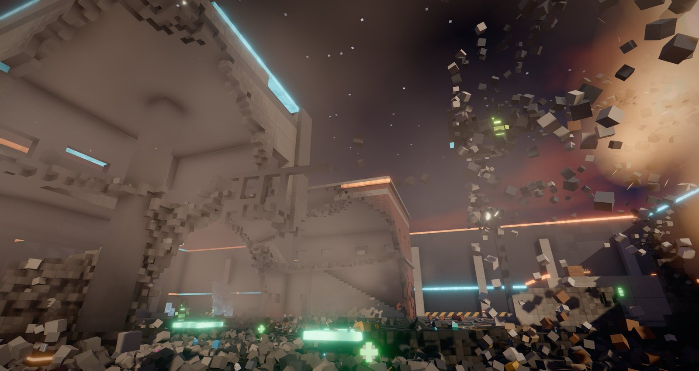
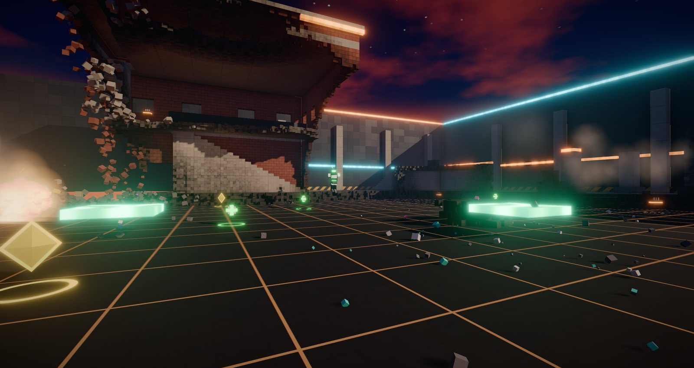
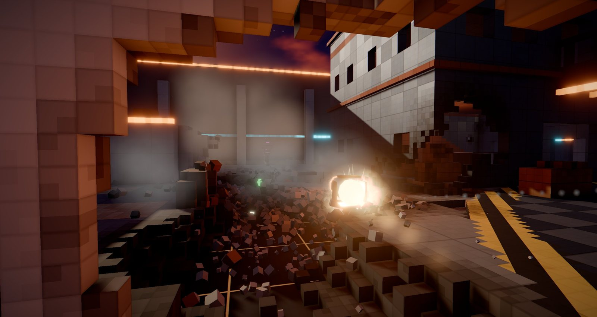
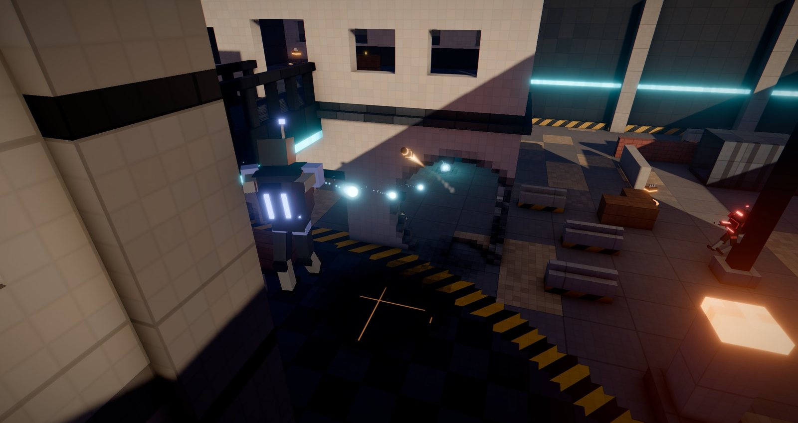

# FragRush — Break, Blast, Bury

**A fast, fully destructible arena shooter that runs in your browser.**
Jump in, no accounts, no setup: fight bots in a neon-lit voxel arena where almost every wall,
column and bridge can be blown apart, and collapsing buildings bury whoever stands below.

**▶ Play now: https://erenciracioglu-dotcom.github.io/FragRush/**



In the spirit of Quake 3 and Unreal Tournament: free-for-all deathmatch against bots, instant
respawn, rocket jumps, bunny hops and dashes. Hiding doesn't work for long, because cover doesn't
last.

| | |
|---|---|
|  |  |

## How to play

| Key | Action |
|---|---|
| WASD | move |
| Space | jump (hold to bunny hop) |
| Shift | dash |
| Ctrl / C | crouch, slide while running |
| Left click | fire |
| Right click | zoom (railgun) |
| 1-5 / wheel / Q | select weapon / previous weapon |
| Tab | scoreboard |
| Esc | menu (pause; *Leave match* returns to the main menu); in menus: back, on the main menu: resume |
| Enter | play / resume |
| F3 | FPS and performance overlay |

**Rocket jump:** fire a rocket at your feet and jump at the same moment.

First to 25 frags (or the leader after 10 minutes) wins, then a fresh arena is generated.

### Weapons

1. **Pulse Rifle**: rapid fire, slowly carves through walls
2. **Shotgun**: close range, shreds cover
3. **Plasma Gun**: fast bolts with small blasts, great for drilling concrete
4. **Rocket Launcher**: big craters, brings structures down, rocket jumps
5. **Railgun**: pierces up to 14 m of wall and hits whoever is behind it

### Doomsday Orb

Spawns on the roof of the central tower, reachable only with jump pads or a rocket jump.
For **15 seconds every hit kills**: every pulse bolt, every shotgun pellet, every plasma bolt,
every rail. Rocket blasts become **5× larger** (≈12 m craters, ≈21 m damage radius). Your own
blasts throw you around but don't hurt you.

### No camping

- Bots hear gunfire, come to where you were last seen and blast through the cover between you.
- Stay in the same small area for more than 15 seconds and **your position is revealed**: the
  three nearest bots learn where you are and come to break your cover (you get a warning at 10 s).
- Walls, columns and bridges break. Anything that loses its connection to the ground collapses
  and crushes what is below. Bring a ceiling down on an enemy and the frag is yours
  ("BURIED IN RUBBLE").

### Settings

Language (English / Türkçe), mouse sensitivity, field of view, graphics quality
(Ultra / High / Medium / Low), bot count (0-11, can be changed mid-match), bot difficulty
(7 levels from Rookie to Nightmare), volume, invert mouse, FPS overlay.
Three of the bots are family: **Papa Eren**, **Eray the Kid** and **Mama Aigul**.



## Requirements

- A desktop browser with **WebGL 2**. Chrome or Edge recommended (tested in Chrome).
- Mouse and keyboard. Mobile is not supported.
- A dedicated GPU is recommended. The game starts on **Low** quality; raise it in Settings if
  your GPU has headroom (press F3 to see FPS).
- No install, no downloads. The online version counts anonymous visits with
  [GoatCounter](https://www.goatcounter.com) (no cookies, no personal data); local copies don't.
- No other network use after the page has loaded (everything, including all sound,
  is generated in the browser).

**Laptops:** if the game stutters or runs slowly, the browser is probably on the integrated GPU
(the menu shows a warning when it is). On one test laptop, Chrome on Intel integrated graphics
froze for up to a second at a time, even on a minimal WebGL test page; on the dedicated GPU it
runs smoothly. On Windows, set
the browser to "High performance" in *Settings → System → Display → Graphics*, or use the
launcher below.

## Run locally

The whole game is a single file: `docs/index.html`. You can open it directly in Chrome.

**Windows launcher:** `FragRush.bat` starts a small local server (if [Node.js](https://nodejs.org)
is installed) and opens the game in a separate fullscreen Chrome window on the high-performance GPU.
The server closes itself about 45 s after the game window is closed.

**From source:**

```
npm install
node build.mjs      # builds dist/index.html and docs/index.html
node serve.mjs      # http://127.0.0.1:8777/
```

## Performance

Measured on an RTX 5080 Laptop at 2560×1362, Ultra:

- ~240 FPS average, 99th percentile frame time 8 ms.
- 30 seconds of non-stop Doomsday rockets (one per second, the arena almost completely leveled,
  ~380k voxels removed): worst frame 12 ms, no frame over 20 ms.
- 5-minute heavy-destruction soak tests: stable memory (no leaks), no shader compiles during play.
- Known issue: in long sessions a rare ~0.5 s hitch can appear every few minutes. It happens inside
  the browser's GPU process / driver, not in the game's own CPU or GPU work.

Benchmark page: `?bench=30&q=ultra` (local server, writes results to `reports/`).

## How it works

- **Three.js r186 + WebGL 2**, bundled with esbuild into one self-contained HTML file (~1 MB).
- **Voxel world**: 72 × 24 × 72 m at 25 cm resolution (~8 million cells). Each material has its own
  toughness and per-voxel damage: concrete cracks and darkens before it breaks, steel holds longer,
  wood and glass break easily. Bedrock and the outer frame are indestructible.
- **Meshing**: greedy meshing with per-vertex ambient occlusion in 6 Web Workers. Changed chunks are
  re-meshed nearest-to-camera first; GPU buffers are allocated with headroom and updated in place,
  and new allocations are spread over frames so huge blasts don't stall the driver.
- **Structural integrity**: after each blast, islands that lost their connection to the ground are
  found with a downward-biased flood fill (~2 ms), fall as rigid bodies and break into debris and
  rubble on impact.
- **Rendering**: sunset sky and environment map, 4K shadow map, N8AO ambient occlusion, bloom, AgX
  tone mapping, color grading, SMAA, per-voxel color variation, bevels and material patterns,
  instanced particles and debris, a fixed-size dynamic light pool (no shader recompiles).
  All shaders are compiled up front.
- **Bots**: multi-level navigation grid that updates as the arena is destroyed, A* pathfinding,
  target selection, strafing, jumping, dashing, rocket dodging, jump pads. When stuck they drill
  through walls.
- **Audio**: fully synthesized with WebAudio at runtime (no sound files), 3D positioned with reverb.

```
src/            source (src/config.js: all tunables in one place)
  world/        voxel world, materials, mesher (+ worker), arena generator, voxel shader
  game/         game loop, movement, weapons, bots, destruction, items, navigation
  fx/           sky, post-processing, particles, debris, lights
  audio/ ui/    sound synthesis, HUD
docs/           built single-file game (served by GitHub Pages)
serve.mjs       dependency-free local server
build.mjs       build script
test/           headless tests (movement, world, flows, screenshots)
tools/          benchmark scripts
```

## Status

Proof of concept, built with Claude. Bots only, no multiplayer (yet). Weapon models and robots are
simple procedural boxes. Very large structures (over 160k voxels) are treated as fixed and don't fall.
Sound starts after the first click (browser rule).

---

## Türkçe

**FragRush**, tarayıcıda çalışan, neredeyse her şeyin parçalanabildiği hızlı bir arena FPS'i.
Hesap yok, kurulum yok: gir, neon ışıklı voxel arenada botlarla kapış, duvarları, kolonları,
köprüleri havaya uçur, çöken binaların altında rakiplerini göm.

**▶ Hemen oyna: https://erenciracioglu-dotcom.github.io/FragRush/**

- Quake 3 / Unreal Tournament ruhu: herkes herkese karşı, ölünce anında yeniden doğuş, roketle
  zıplama, tavşan zıplaması, atılma. 25 parçalamaya ulaşan (ya da 10 dakika sonunda önde olan)
  kazanır, ardından yeni bir arena kurulur.
- **Dil:** oyun İngilizce açılır; *SETTINGS → Language* ile Türkçeye geçilir (seçim hatırlanır).
- **Silahlar:** Darbe Tüfeği, Saçmalı, Plazma, Roketatar, Raylı Tüfek (duvarın arkasını vurur).
- **KIYAMET küresi:** merkez kulenin çatısında çıkar. 15 saniye boyunca her isabet öldürür,
  roket patlamaları 5 kat büyür. Kendi patlaman sana hasar vermez.
- **Saklanmak işe yaramaz:** botlar silah sesini duyar ve siperi deler; 15 saniyeden uzun aynı
  yerde kalırsan konumun açığa çıkar. Bağlantısı kopan yapılar çöker ve altındakini ezer.
- **Ayarlar:** dil, fare hassasiyeti, görüş alanı, grafik kalitesi, bot sayısı (0-11, maç
  sırasında da değişir), 7 kademe bot zorluğu (Acemi'den Kâbus'a), ses. Botlardan üçü aile:
  Papa Eren, Eray the Kid ve Mama Aigul.
- **Gereksinim:** WebGL 2 destekli masaüstü tarayıcı (Chrome / Edge önerilir), fare ve klavye.
  Harici ekran kartı önerilir; dahili ekran kartında *Medium* ya da *Low* seç. Dizüstünde yavaşsa
  Windows *Ayarlar → Sistem → Ekran → Grafik* bölümünden tarayıcıyı "Yüksek performans"a al.
- **Yerelde:** `docs/index.html` tek dosyadır, doğrudan açılabilir. Windows'ta `FragRush.bat`
  yerel sunucuyu açar ve oyunu ayrı, tam ekran bir Chrome penceresinde harici ekran kartıyla başlatır.
  Kaynaktan derlemek için `npm install` ve `node build.mjs`.

## License

[MIT](LICENSE)
